## Praktikum 6 : Javascript-DOM Event ##

Berikut hasil praktikum saya pada praktikum 6 : Javascript-DOM Event

## Latihan 1 : Mengubah teks dengan DOM
Pada saat di run, pada kalimat belajar javascript dom berubah menjadi bold dan ukurannya terlihat besar. Dan pada kalimat konten berhasil diubah oleh javascript berubah menjadi teks biasa.

## Latihan 2 : Event click
Pada tombol tulisan klik saya, akan merespon tulisan lain yaitu tombol diklik pada jam kita klik.

## Latihan 3 : Mengubah kelas dan gaya css
Pada kalimat ini adalah teks untuk latihan mengubah gaya css, saat kita menekan tombol ubah gaya teks akan berubah menjadi css yang kita tentukan.

## Latihan 4 : Event input dan penghitung karakter
Diberikan textbox untuk menuliskan nama yang di input, dan saat diisi akan tomatis mengikuti jumlah huruf yang kita masukkan.

## Latihan 5 : Validasi form pendaftaran
Membuat form pendaftaran dari nama lengkap, email, dan usia dari 17-100. Pada saat kita kurang lengkap memasukkan email, maka akan ada peringatan muncul bahwa email tidak valid. Pada saat kita isi umur di bawah 17, maka akan ada peringatan umur harus bilangan 17-100.

## Latihan 6 : Daftar tugas sederhana
Membuat textbox yang nantinya diinput dan masuk dalam daftar list. Pada nama tugas yg dimasukkan ke dalam list, akan muncul pilihan hapus dan juga sudah selesai mengerjakan. Saat kita menekan tombol sudah selesai, tugas akan dicoret otomatis.

## Mini Project - form pendaftaran workshop
Membuat form pendaftaran yg di dalamnya berisi nama, email dan pilihan sesi. 

## Lanpiran
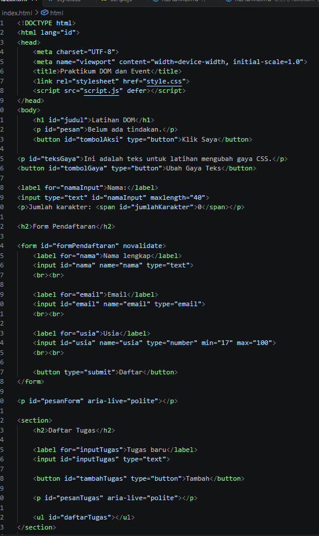
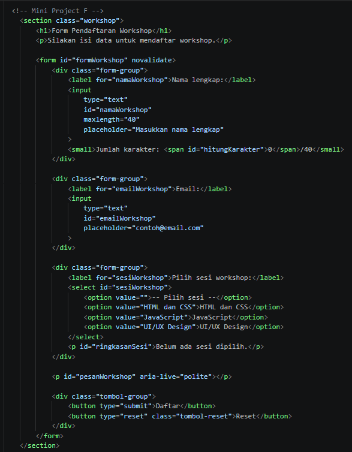
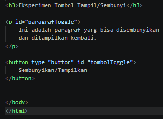
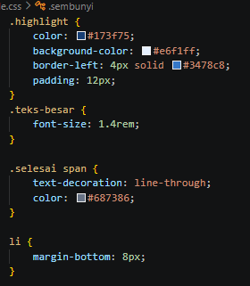
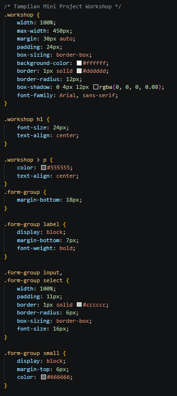
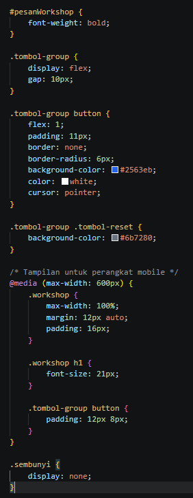
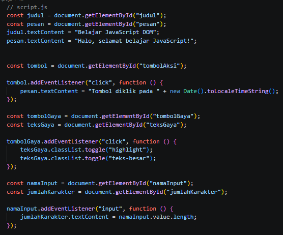
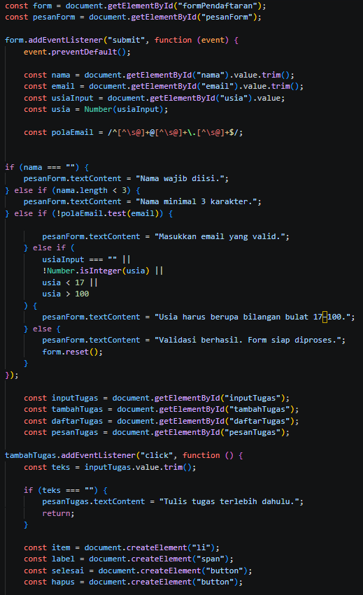
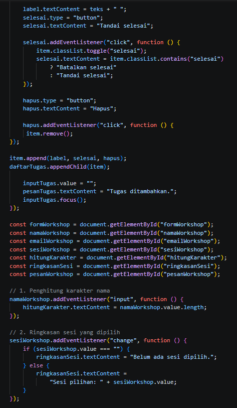
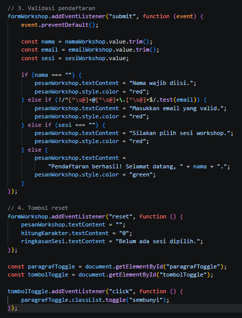
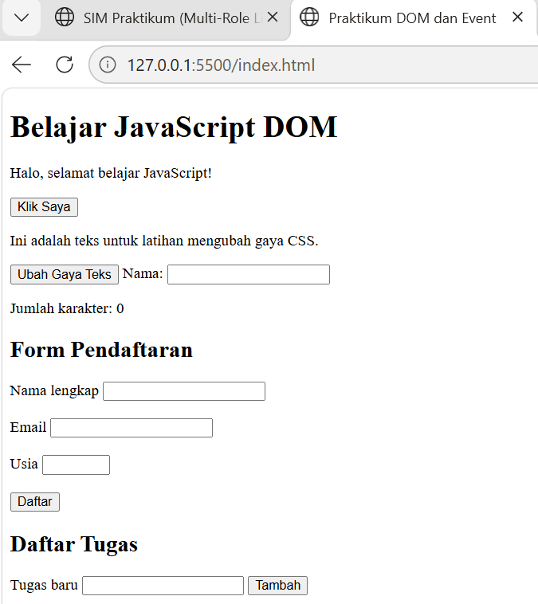
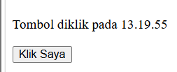
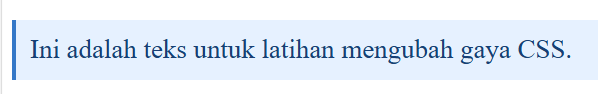
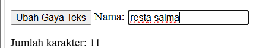
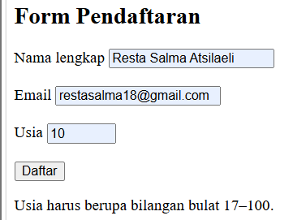
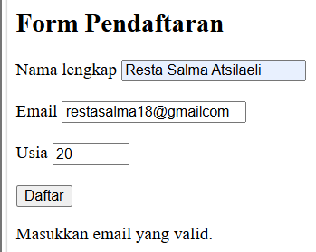
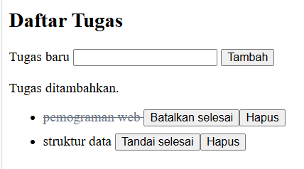
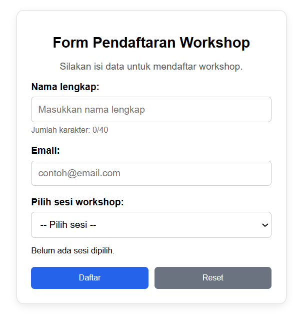
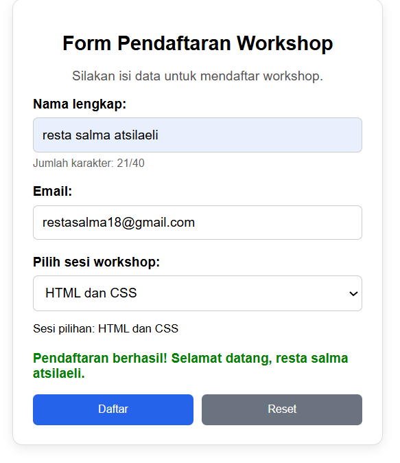
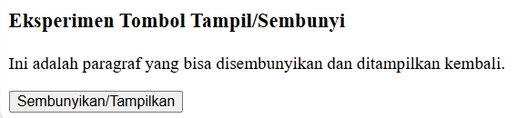
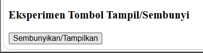

1. Apa yang dimaksud dengan DOM dan apa manfaatnya?
DOM (Document Object Model) adalah representasi struktur dokumen HTML dalam bentuk objek yang dapat diakses oleh JavaScript. DOM bermanfaat untuk memilih elemen, mengubah teks dan atribut, mengatur kelas CSS, serta menambahkan elemen baru sehingga halaman web dapat berubah secara dinamis.
2. Apa perbedaan getElementById(), querySelector(), dan querySelectorAll()?
getElementById() memilih satu elemen berdasarkan id. querySelector() memilih elemen pertama yang cocok dengan selector CSS, misalnya #judul atau .pesan. querySelectorAll() memilih seluruh elemen yang cocok dan menghasilkan kumpulan elemen yang dapat diperiksa satu per satu.
3. Apa fungsi addEventListener() dan sebutkan tiga contoh event?
addEventListener() menghubungkan suatu kejadian dengan fungsi yang akan dijalankan saat kejadian tersebut berlangsung. Contohnya click ketika tombol ditekan, input ketika isi kotak teks berubah, dan submit ketika form dikirim.
4. Mengapa event.preventDefault() digunakan pada event submit form?
event.preventDefault() mencegah perilaku bawaan browser, yaitu mengirim form dan memuat ulang halaman. Dengan demikian, JavaScript dapat memeriksa data terlebih dahulu dan menampilkan pesan validasi pada halaman yang sama.
5. Apa perbedaan textContent dan innerHTML dari sisi penggunaan dan keamanan?
textContent digunakan untuk membaca atau mengubah teks biasa di dalam elemen. innerHTML digunakan untuk membaca atau mengubah isi elemen yang dapat mencakup markup HTML. Untuk menampilkan masukan pengguna, textContent lebih aman karena teks tidak diperlakukan sebagai kode HTML.
6. Bagaimana classList.toggle() membantu mengubah tampilan elemen?
classList.toggle() menambahkan suatu kelas jika kelas itu belum ada dan menghapusnya jika sudah ada. Cara ini berguna untuk mengaktifkan atau menonaktifkan gaya CSS, misalnya memperbesar tulisan atau memberi warna latar saat tombol diklik.
7. Sebutkan minimal tiga skenario pengujian validasi form.
Contoh skenario pengujian adalah seluruh kolom dibiarkan kosong, email diisi dengan format yang tidak benar, usia diisi di bawah 17, dan seluruh data diisi sesuai ketentuan. Pengujian tersebut memastikan pesan kesalahan maupun pesan berhasil tampil pada kondisi yang tepat.

